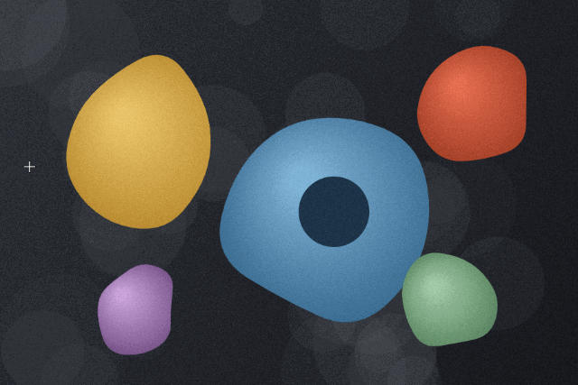
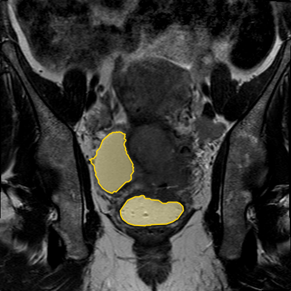

# intelligent-scissors

[](https://www.npmjs.com/package/intelligent-scissors)
[](https://github.com/nicolasbopp/intelligent-scissors/actions/workflows/ci.yml)
[](LICENSE)

Live-wire segmentation for the browser, also known as Intelligent Scissors or the magnetic
lasso. You click a few points around an object, and the outline between them follows the
object's edges.



[Live demo](https://nicolasbopp.github.io/intelligent-scissors/) · [Examples](examples/) · [Changelog](CHANGELOG.md)

I wrote the first version for an MRI annotation tool in my master's thesis and later split it
out, because I couldn't find a small standalone implementation. OpenCV.js has one, but that
means shipping several megabytes of WASM, and the others I found only work inside one
particular viewer. This package has no dependencies, works on a plain `<canvas>` or inside
your own viewer, reads 16-bit medical images directly, and is under 6 kB gzipped.

The demo has a few images to try it on: a pelvic MRI slice and a
microscopy image. You can also drop in your own.

## Contents

- [Install](#install)
- [Getting started](#getting-started)
- [Using it in your own viewer](#using-it-in-your-own-viewer)
- [Medical and other grayscale images](#medical-and-other-grayscale-images)
- [Masks and COCO export](#masks-and-coco-export)
- [Tracing long boundaries](#tracing-long-boundaries)
- [Large images](#large-images)
- [Options](#options)
- [API](#api)
- [Tuning](#tuning)
- [How it works](#how-it-works)
- [Performance](#performance)
- [Limitations](#limitations)
- [Development](#development)

## Install

```sh
npm install intelligent-scissors
```

It ships as ES modules and CommonJS with type declarations, and has no dependencies.

## Getting started

`attachScissors` turns a `<canvas>` into a complete tracing tool:

```ts
import { attachScissors } from 'intelligent-scissors/canvas';

const img = document.querySelector('img')!;
await img.decode();

const tool = attachScissors(document.querySelector('canvas')!, {
  image: img,
  onComplete(polygon) {
    console.log(polygon); // [{ x, y }, ...] in image pixels
  },
});
```

| Input | What happens |
| --- | --- |
| Click | Places an anchor. It jumps to the strongest edge within a few pixels. |
| Mouse move | The path from the last anchor to the pointer follows the edges. |
| Shift held | The path is a straight line instead, for stretches without a usable edge. |
| Double-click, Enter, or a click on the first anchor | Closes the shape. |
| Backspace | Removes the last anchor. |
| Esc | Discards the current shape. |

The canvas takes the size of the image, so scale it with CSS. Finished polygons are in
`tool.shapes` and are passed to `onComplete`. If you already show the image somewhere and
only need the outlines on top, pass `background: 'none'` and lay the canvas over your image.

## Using it in your own viewer

If you need your own rendering, zoom, or input handling, use `ScissorsSession` directly. It
keeps track of anchors and paths but never touches the DOM. You pass it pointer positions in
image pixels and draw what it returns:

```ts
import { createScissors, ScissorsSession } from 'intelligent-scissors';

const session = new ScissorsSession(createScissors(imageData));

viewer.on('click', e => {
  if (session.click(toImagePixels(e)) === 'closed') save(session.polygon());
});

viewer.on('pointermove', e => {
  session.move(toImagePixels(e));
  draw(session.segments, session.livePath, session.anchors);
});
```

`segments` are the fixed parts between anchors, `livePath` is the part that follows the
pointer. [examples/custom-viewer.ts](examples/custom-viewer.ts) has a complete version with
zoom and pan. The same pattern works in Konva, Fabric, OpenSeadragon, Cornerstone, or a
WebGL viewer.

## Medical and other grayscale images



Grayscale input can be any numeric array, for example the `Uint16Array` or `Int16Array` of
an MRI or CT slice. It is used at full precision, not squeezed into 8 bits first. A window
(centre and width, as in a DICOM viewer) restricts edge detection to the intensity range
you are interested in, so edges outside that range stop attracting the path:

```ts
import { attachScissors } from 'intelligent-scissors/canvas';

attachScissors(canvas, {
  image: {
    data: slice,      // Int16Array, Uint16Array, Float32Array, ...
    width: 512,
    height: 512,
    window: { center: 40, width: 400 },
  },
  sigma: 1.5,
});
```

The canvas tool shows the windowed image. To change the window without losing the traced
shapes, call `tool.setImage({ ...input, window }, { keepShapes: true })`. The demo does this
with its brightness and contrast sliders on the MRI example.

To turn a traced outline into a segmentation mask, use `polygonToMask(polygon, width,
height)`. It returns a `Uint8Array` with 1 for every pixel inside or on the outline.
[examples/grayscale-mask.ts](examples/grayscale-mask.ts) runs in Node and shows the whole
process without a browser.

## Masks and COCO export

Annotations usually end up in a training format, and models give you masks that you want to
show or correct as outlines. `intelligent-scissors/mask` has the conversions for both
directions. It doesn't depend on the tracing code, so you can use it on its own.

```ts
import {
  polygonToMask, maskToPolygons, encodeRle, decodeRle, maskArea, maskBounds, maskIoU,
} from 'intelligent-scissors/mask';

// A traced polygon as a COCO annotation
const mask = polygonToMask(polygon, width, height);
const box = maskBounds(mask, width, height)!;
const annotation = {
  segmentation: encodeRle(mask, width, height, { compress: true }),
  area: maskArea(mask),
  bbox: [box.x, box.y, box.width, box.height],
  iscrowd: 1,
};

// A mask from a model as outlines, one per region
const { mask: predicted } = decodeRle(prediction.segmentation);
const outlines = maskToPolygons(predicted, width, height, { simplify: 0.75 });

// How well two masks agree
const iou = maskIoU(mask, predicted);
```

- `encodeRle` produces what pycocotools reads: runs down the columns, `size` as
  `[height, width]`, and `counts` either as numbers or, with `compress`, as the compact
  string. `decodeRle` reads both. The tests compare the output with pycocotools.
- `maskToPolygons` returns the outer boundary of each 8-connected region. Holes are not
  represented; a ring comes back as a filled disc. Keep such masks as RLE.
- A mask is any array with one value per pixel, row by row; non-zero means inside.

[examples/coco-export.ts](examples/coco-export.ts) runs the whole way in Node.

## Tracing long boundaries

With `autoAnchor` set, the tool places anchors by itself. Whenever the start of the live
path has stayed the same over several mouse moves, it fixes that part and starts a new
segment from its end. The original paper calls this path cooling. In practice you click
once, move the mouse roughly along the boundary, and only add clicks where the path takes
a wrong turn.

```ts
attachScissors(canvas, { image, autoAnchor: 12 });
```

The number is how many consecutive moves a pixel has to stay on the path. Lower values
place anchors sooner. `autoAnchorMinLength` (default 30 px) prevents very short segments.

## Large images

Finding a path means running Dijkstra's algorithm outward from the last anchor. Near the
anchor that takes milliseconds. A jump across a large image, though, can mean visiting
most of its pixels. The canvas tool therefore never searches for more than about 8 ms per
animation frame. The page stays responsive and the path appears once the search has reached
the pointer.

In your own viewer you can do the same with `searchTowards`:

```ts
function update() {
  if (scissors.searchTowards(pointer, 20_000)) {
    draw(session.move(pointer)); // the path is known now, move() returns immediately
  } else {
    requestAnimationFrame(update); // continue in the next frame
  }
}
```

Computing the cost map takes about a quarter of a second for a 1.7-megapixel image. For much
larger images, scale down before tracing and scale the polygon back up.

## Options

These work for `createScissors` and `attachScissors`:

| Option | Default | |
| --- | --- | --- |
| `weights` | `{ laplacian: 0.43, gradient: 0.43, direction: 0.14 }` | Weighting of the three cost terms, see [How it works](#how-it-works). |
| `sigma` | `1` | Gaussian blur in pixels before edge detection. Increase it for noisy images. |
| `zeroCrossingThreshold` | `0.1` | Ignores Laplacian zero crossings where the gradient is weaker than this fraction of the image's strongest gradient. |

These work for `ScissorsSession` and `attachScissors`:

| Option | Default | |
| --- | --- | --- |
| `snapRadius` | `4` | A clicked anchor moves to the strongest edge within this radius. `0` turns it off. |
| `closeRadius` | `6` | A click this close to the first anchor closes the shape. |
| `autoAnchor` | `0` | Path cooling, see [Tracing long boundaries](#tracing-long-boundaries). `0` turns it off. |
| `autoAnchorMinLength` | `30` | Shortest segment, in pixels, that path cooling will fix. |

These only exist for `attachScissors`:

| Option | Default | |
| --- | --- | --- |
| `style` | yellow outline, cyan live path | Colours, line width and anchor size. The sizes are in CSS pixels, so lines look the same however the canvas is scaled. |
| `background` | `'image'` | `'none'` for a transparent overlay, or a function that draws its own background. |
| `simplify` | `0` | Tolerance in pixels for simplifying finished polygons. Traced paths have one point per pixel; a value of 0.5 to 1 removes most of them without changing the shape. |
| `keyboard` | `true` | Enables Esc, Backspace and Enter on the focused canvas. Shift for straight lines always works. |
| `onComplete` | | Called with each finished polygon. |
| `onChange` | | Called after every change, for updating your own UI. |

## API

**`intelligent-scissors`**

- `createScissors(image, options?)` computes the cost map and returns an `IntelligentScissors`:
  - `setSeed(point)` starts a new search from a pixel.
  - `pathTo(point)` returns the cheapest path from the seed to `point`, both ends included.
  - `searchTowards(point, maxSteps)` extends the search by at most `maxSteps` pixels and returns whether `point` was reached.
  - `hasPathTo(point)` tells whether `pathTo(point)` would return without searching.
  - `snap(point, radius)` returns the pixel on the strongest edge within `radius`.
  - `costMap` holds the per-pixel features.
- `new ScissorsSession(scissors, options?)` manages one shape:
  - `click(point, { straight? })` returns `'started'`, `'anchored'`, `'closed'` or `'ignored'`.
  - `move(point, { straight? })` updates the live path. With `straight`, both connect with a
    straight line instead of following edges.
  - `close()`, `undo()`, `reset()` and `polygon()`.
  - `anchors`, `segments`, `livePath`, `started`, `closed` and `canClose` for drawing.
- `simplifyPath(points, tolerance)` simplifies a path with Ramer–Douglas–Peucker.
- `polygonToMask(polygon, width, height)` fills a closed outline into a mask.
- `polygonArea(polygon)` returns the enclosed area in square pixels.
- `computeCostMap(image, options?)` and `costMapToRGBA(map)` give direct access to the cost map, for example to visualise it as the demo does.

**`intelligent-scissors/mask`**

- `maskToPolygons(mask, width, height, { simplify?, minPixels? })` returns one outline per region.
- `encodeRle(mask, width, height, { compress? })` and `decodeRle(rle)` convert to and from COCO RLE.
- `maskArea(mask)`, `maskIoU(a, b)` and `maskBounds(mask, width, height)`.
- `polygonToMask`, `polygonArea` and `simplifyPath` are exported here as well.

**`intelligent-scissors/canvas`**

- `attachScissors(canvas, options)` returns a `ScissorsTool` with `shapes`, `session`,
  `scissors`, `image`, and the methods `close()`, `undo()`, `cancel()`, `clear()`,
  `setImage(image, { keepShapes? })`, `configure(options)`, `redraw()` and `destroy()`.

Everything is typed, and the type declarations carry the documentation, so your editor
shows it.

### Coordinates

All points are in image pixels, with `{ x: 0, y: 0 }` at the top-left pixel. Paths contain
one point per pixel and every point is a direct neighbour, diagonals included, of the one
before. Positions outside the image are clamped to the border. The canvas tool draws lines
through pixel centres, that is, at `x + 0.5`. Do the same in your own rendering or the outline
will look shifted by half a pixel.

## Tuning

The defaults work for most photos. Some adjustments that help:

- **Noisy images** (low-dose CT, fluorescence, phone photos in low light): raise `sigma` to
  1.5 to 3. The path then ignores grain and follows the larger structures.
- **Textured tissue** such as histology: raise `sigma` as well. If the path still jumps
  between nearby fibres, increase the `direction` weight a little, which makes it prefer
  smooth curves.
- **Low-contrast MRI or CT**: set a window around the intensities of the structure you are
  tracing. That usually helps more than changing the weights.
- **Path cuts corners**: lower `snapRadius`, or place anchors a bit more often at sharp bends.
- **Path gives up on faint edges**: lower `zeroCrossingThreshold`, for example to 0.05.

The cost map view in the demo shows what the algorithm sees. If an edge you want is not
dark there, no weighting will make the path follow it.

## How it works

The method comes from Mortensen and Barrett, *Intelligent Scissors for Image Composition*,
SIGGRAPH 1995.

The image is treated as a graph in which every pixel connects to its eight neighbours. A
step from one pixel to the next has a cost that combines three terms:

- **Laplacian zero crossing.** Zero exactly on an edge, one elsewhere. Keeps the path on the
  edge rather than next to it.
- **Gradient magnitude.** Low where the intensity changes strongly.
- **Gradient direction.** Low when the step runs along the edge, high when it cuts across
  it. Keeps the path smooth.

These features are computed once per image, after an optional Gaussian blur. Each click
starts Dijkstra's algorithm from the new anchor. The search is incremental: `pathTo` only
continues until the pointer's pixel is reached and picks up from there on the next call, so
moving the mouse near the anchor costs almost nothing. Path cooling builds on the fact that
all paths from one anchor form a tree. Two consecutive paths share a common beginning, and
the pixels in it are the ones that can be fixed.

## Performance

Measured in headless Edge on a laptop:

| | 1.7 MP image (1600 × 1067) |
| --- | --- |
| Cost map | 0.2 to 0.4 s, once per image |
| Path to a point 150 px from the anchor | about 30 ms |
| Longest frame while searching across the whole image | 17 ms |

## Limitations

- It works on single 2D images. For volumes you trace slice by slice.
- The canvas tool is made for a mouse or pen. On a touch screen you can tap anchors, but
  there is no live path between taps.
- Finished shapes can't be edited. To correct one you trace it again.
- Colour images are converted to luminance first. An edge between two colours of the same
  brightness, say red against green, is invisible to it.
- For objects with a clear outline, a segmentation model such as SAM gives you a mask with
  one click. Live-wire is the better fit when you need to decide exactly where the boundary
  runs, when you don't want to download or run a model, or when no model knows your kind of
  image.

## Demo images

The images in the demo are freely licensed:

- Pelvic MRI: TCGA-CESC collection, The Cancer Imaging Archive.
  Lucchesi, F. R., & Aredes, N. D. (2016),
  [doi:10.7937/K9/TCIA.2016.SQ4M8YP4](https://doi.org/10.7937/K9/TCIA.2016.SQ4M8YP4),
  [CC BY 3.0](https://creativecommons.org/licenses/by/3.0/). Data generated by the TCGA
  Research Network.
- Cell: Müller et al., *Optics Express* 26(8), 2018, CC0, distributed with
  [scikit-image](https://scikit-image.org/).

## Roadmap

- A React hook
- Moving the anchors of a finished shape
- On-the-fly training, where the cost adapts to the edge you are currently following
- Optional Web Worker for computing the cost map of very large images

Issues and pull requests are welcome.

## Development

```sh
pnpm install
pnpm dev         # demo on http://localhost:5173
pnpm test
pnpm typecheck   # also checks examples/
pnpm build       # ESM, CJS and type declarations in dist/
```

## License

[MIT](LICENSE). The demo images keep their own licences, listed above.
